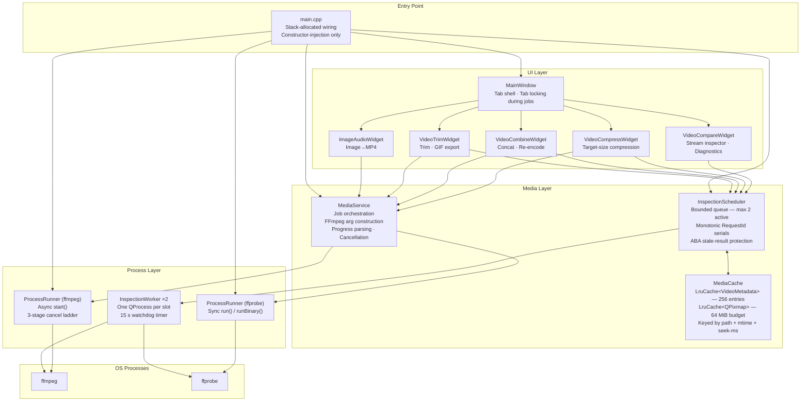

# Picture This

> A fast, lightweight C++20 / Qt 6 desktop media utility powered by FFmpeg.

**Picture This** is a desktop application that wraps `ffmpeg` and `ffprobe` with a clean, event-driven C++ architecture. Rather than linking against FFmpeg C libraries or blocking the GUI during media operations, it orchestrates child OS processes and communicates over standard pipes—keeping the interface responsive and resource-efficient.

---

## Features

| Tab | Capability |
|-----|-----------|
| **Image to Video** | Combine a still image + audio track into an MP4 — clipboard paste, drag-and-drop, High-DPI preview |
| **Trim Video** | Frame-accurate or keyframe-aligned trim; Animated GIF export with Lanczos + Bayer-dithered palettegen |
| **Combine Videos** | Lossless stream-copy concat (matching codecs) or smart filter-complex re-encode (mismatched resolutions) |
| **Compress Video** | Percentage-based target-size compression; adaptive bitrate split; optional 2-pass encoding |
| **Compare Videos** | Side-by-side stream inspector — container, video, audio params; green/amber diff badges; codec compliance diagnostics |

---

## Architecture

### Three-layer separation

```
┌─────────────────────────────────────────────────────┐
│  UI Layer  (src/ui/)                                │
│  Widgets know nothing about FFmpeg.                 │
│  They call named methods; react to typed signals.   │
├─────────────────────────────────────────────────────┤
│  Media Layer  (src/media/MediaService,              │
│               InspectionScheduler, MediaCache)      │
│  Builds argument lists, orchestrates jobs,          │
│  manages async inspection and caching.              │
├─────────────────────────────────────────────────────┤
│  Process Layer  (src/media/ProcessRunner,           │
│                  InspectionWorker)                  │
│  Launches processes, streams stdout/stderr,         │
│  drives the cancellation escalation ladder.         │
└─────────────────────────────────────────────────────┘
```

### Component diagram



---

## Key Implementation Highlights

### 1 · Zero-disk-churn thumbnail extraction (IPC over stdout pipe)

Thumbnails are extracted without writing any intermediate file to disk. `ffmpeg` is invoked with `-f image2pipe -vcodec mjpeg -` which makes it write raw MJPEG bytes directly to stdout. The application reads those bytes from the `QProcess` pipe and loads them directly into a `QPixmap` via `QPixmap::loadFromData()`.

```
ffmpeg -ss <seek> -i <file> -vframes 1 -f image2pipe -vcodec mjpeg -
           ↓ stdout pipe (binary)
       QProcess::readAllStandardOutput()
           ↓
       QPixmap::loadFromData(bytes, "JPG")
```

No temp files. No disk I/O. No cleanup path.

---

### 2 · Bounded concurrency and ABA stale-result protection

`InspectionScheduler` limits simultaneously-running `ffprobe`/`ffmpeg` inspection processes to a configurable ceiling (default: **2**). Requests beyond that threshold are held in a prioritised `QList` queue; high-priority requests are prepended.

Every request is stamped with a **monotonic `uint64_t` serial** — the `RequestId`:

```cpp
struct RequestId {
    uint64_t serial;       // monotonically increasing; 0 == invalid
    QString  filePath;
    double   timestampSeconds;
    QString  purpose;      // e.g. "compare_meta_a", "trim_thumb_start"
};
```

When a stale result arrives (user swapped files before probe completed), the UI widget simply compares the incoming `result.id` to its latest `m_pendingMetaIdA` — if the serials don't match the result is dropped without touching the UI. Classic ABA protection with zero locking.

```
Request A issued  → serial 42 stored in widget
User changes file → Request B issued → serial 43 stored
Result for serial 42 arrives → 42 ≠ 43 → discarded silently
Result for serial 43 arrives → 43 == 43 → accepted, UI updated
```

---

### 3 · Byte-budgeted LRU cache with mtime self-invalidation

`MediaCache` wraps two independent `LruCache<V>` instances using the classic `std::list + std::unordered_map` structure:

| Store | Eviction policy | Key |
|-------|----------------|-----|
| `LruCache<VideoMetadata>` | Count ≤ 256 | `{filePath, mtime}` |
| `LruCache<QPixmap>` | Count ≤ 50 **and** bytes ≤ 64 MiB | `{filePath, mtime, seekMs}` |

Cache entries are keyed by `(filePath, mtime, seekTimestampMs)`. `mtime` is read from `QFileInfo::lastModified()` at key-construction time. When a file is modified on disk, the next `makeKey()` call yields a **different mtime** — the old entry simply never matches again and is evicted by the LRU policy. No explicit invalidation timer needed.

```
get() → O(1):  map lookup → list splice to front (MRU promotion)
put() → O(1):  map insert + list push_front → evictUntilFit()
```

---

### 4 · Three-stage process cancellation ladder

Cancellation is completely non-blocking. `ProcessRunner::cancel()` initiates an escalating sequence driven by `QTimer` callbacks — the UI is never blocked waiting for a process to die:

```
Stage 1  write "q" to ffmpeg stdin     → ffmpeg flushes container, exits cleanly
         ↓ (3 s timeout)
Stage 2  Windows: TerminateProcess()
         POSIX:   SIGTERM              → one more chance to flush
         ↓ (1 s timeout, POSIX only)
Stage 3  POSIX: SIGKILL               → unconditional termination
```

FFmpeg monitors its own stdin and exits cleanly on `q` — flushing the MP4 `moov` atom, closing the container. This is the reason output files are not truncated or corrupted on user-initiated cancel. Force-kill is strictly a last resort.

The destructor runs a synchronous fast-path (`waitForFinished(1500ms)` → `kill()`) to ensure the `QProcess` member is fully stopped before the object is destroyed — RAII safety.

---

### 5 · Codec and platform compliance diagnostics

`VideoCompareWidget` runs a static analysis pass on both loaded files' `VideoMetadata` and emits labelled findings:

| Check | Trigger | Why it matters |
|-------|---------|---------------|
| Mod-2 dimension | `width % 2 ≠ 0 ∥ height % 2 ≠ 0` | H.264 / HEVC require even dimensions; odd sizes cause encoder rejection or hardware decoder artifacts |
| High bit-depth / non-4:2:0 | pixel format contains `10`, `12`, `422`, or `444` | 10-bit and 4:4:4 content fails hardware decode on most mobile SoCs and consumer platforms |
| H.264 High 10 / High 4:2:2 profile | profile string contains those substrings | Unsupported on many mobile hardware decoders |
| Missing audio track | A has audio, B does not (or vice versa) | Signals a strip-audio bug in a compression pipeline |
| Container format change | `formatName` differs | Documents a re-mux step; flags MP4→MKV regressions |
| File size delta | `|B - A| / A > 2%` | Quantifies compression ratio or unexpected size growth |

---

## Build

### Requirements

| Dependency | Version | Notes |
|-----------|---------|-------|
| Qt | 6.x | Widgets module only |
| C++ compiler | C++20 | GCC 13 / Clang 16 / MSVC 19.38+ |
| CMake | 3.21+ | |
| FFmpeg + FFprobe | Any modern | Runtime only — not linked |

### Windows (Qt Online Installer + MinGW)

```powershell
# Configure (MinGW Makefiles)
cmake -S . -B build -G "MinGW Makefiles" `
      -DCMAKE_PREFIX_PATH="C:/Qt/6.x.x/mingw_64"

# Build
cmake --build build -j8

# Run (Qt DLLs must be on PATH or deployed)
$env:PATH = "C:\Qt\6.x.x\mingw_64\bin;$env:PATH"
.\build\PictureThis.exe
```

### Linux (system Qt6)

```bash
# Debian / Ubuntu
sudo apt install qt6-base-dev cmake g++

cmake -S . -B build
cmake --build build -j$(nproc)
./build/PictureThis
```

### AddressSanitizer build

```bash
cmake -S . -B build-asan -DENABLE_ASAN=ON
cmake --build build-asan -j$(nproc)
./build-asan/PictureThis
```

---

## FFmpeg Setup

The application auto-discovers `ffmpeg` and `ffprobe` by searching, in order:

1. User-saved custom path (stored in `QSettings`)
2. Application directory and `./bin/` subdirectory
3. System `PATH` (`QStandardPaths::findExecutable`)

If neither tool is found, a warning banner is shown at startup with a **Configure Tools...** button. Paths can be overridden at any time in the Settings dialog — changes take effect immediately without restarting.

**Windows quickstart:**
```powershell
winget install Gyan.FFmpeg
# or download a build from https://ffmpeg.org/download.html and add to PATH
```

**Linux:**
```bash
sudo apt install ffmpeg        # Debian/Ubuntu
sudo dnf install ffmpeg        # Fedora
sudo pacman -S ffmpeg          # Arch
```

---

## Tests

```bash
# Build and run the full test suite
cmake --build build
$env:PATH = "C:\Qt\6.x.x\mingw_64\bin;$env:PATH"   # Windows
.\build\tests\test_media_cache.exe
.\build\tests\test_inspection_scheduler.exe
```

| Test suite | Cases | Coverage |
|-----------|-------|---------|
| `test_media_cache` | 10 | `LruCache<T>` get/put, recency promotion, count eviction, byte-budget eviction, in-place update, `removeByPath`, mtime self-invalidation, thumbnail byte tracking |
| `test_inspection_scheduler` | 9 | Monotonic serials, bounded concurrency (≤ 2 active), priority preemption, cancel by ID / purpose / file / all, cached immediate dispatch |

Tests use **Qt Test** and link only the systems-layer translation units — no UI, no `MediaService`, no QApplication (except for `InspectionWorker` which needs a minimal `QCoreApplication`).

---

## Project Structure

```
src/
├── main.cpp                     Stack-allocated wiring, no heap at top level
├── media/
│   ├── ProcessRunner.{h,cpp}    Async QProcess wrapper + 3-stage cancel ladder
│   ├── MediaService.{h,cpp}     Job orchestration, FFmpeg arg construction
│   ├── InspectionScheduler.{h,cpp}  Bounded async probe queue (max 2)
│   ├── InspectionWorker.{h,cpp} Per-slot QProcess + 15s watchdog
│   ├── MediaCache.{h,cpp}       LRU cache (VideoMetadata + QPixmap)
│   ├── VideoMetadata.h          POD struct — no QObject dependency
│   ├── InspectionTypes.h        RequestId, InspectionTask, ProbeResult, ThumbnailResult
│   └── ExecutableLocator.{h,cpp}  4-tier binary discovery + validation
└── ui/
    ├── MainWindow.{h,cpp}       Tab shell, job tab-locking, clean-shutdown guard
    ├── ImageAudioWidget.{h,cpp} Tab 1
    ├── VideoTrimWidget.{h,cpp}  Tab 2 + debounced thumbnail requests
    ├── VideoCombineWidget.{h,cpp} Tab 3 + progressive probing
    ├── VideoCompressWidget.{h,cpp} Tab 4 + 2-pass compress
    ├── VideoCompareWidget.{h,cpp}  Tab 5 + compliance diagnostics
    ├── RangeTimelineWidget.{h,cpp} Custom QPainter timeline bar
    └── SettingsDialog.{h,cpp}   Tool path config + live validation

tests/
├── test_media_cache.cpp          10 Qt Test cases for LruCache + MediaCache
└── test_inspection_scheduler.cpp  9 Qt Test cases for InspectionScheduler

dev_docs/
├── Architecture.md              Internal deep-dive (class inventory, sequence diagrams, design rationale)
├── Picture_This_Requirements_and_Handoff.md
└── Picture_This_V1_Hardening_and_Release_Plan.md
```

---

## Licence

MIT
